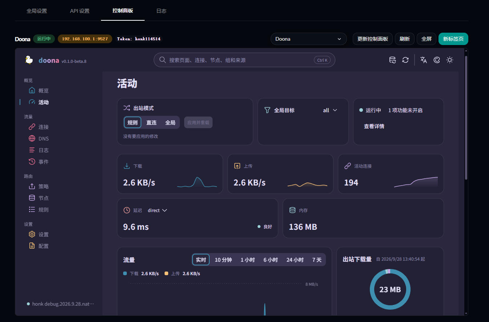

# luci-app-honk

OpenWrt 上的 honk（基于 eBPF 的高性能透明代理引擎，dae 兼容）LuCI 管理界面与安装包。

## 仓库组件

本仓库包含两个 OpenWrt 软件包：

| 包名 | 类型 | 说明 |
| :--- | :--- | :--- |
| **`luci-app-honk`** | 管理界面 | 基于 LuCI 与 Ucode 构建的 Web 控制界面与 rpcd 服务 |
| **`honk`** | 核心服务 | 从 [daeuniverse/honk](https://github.com/daeuniverse/honk) Release 下载预编译静态 `honk-core` 并配置 init.d 守护进程 |

> [!NOTE]
> 目前 `honk-core` 仅提供 `x86_64` 与 `aarch64` 的预编译 musl 静态二进制。

## 编译与安装

### 1. 宿主机构建依赖 (以 Ubuntu 为例)

编译 `honk-core` 核心二进制需在宿主机配置 Rust、bpf-linker 与 Zig（用于 BoringSSL musl 交叉编译）：

```bash
# 基础依赖与 LLVM/BPF 工具链
sudo apt-get update
sudo apt-get install -y clang llvm libbpf-dev cmake libclang-dev zstd

# Rust 与 Target (以 x86_64 / aarch64 为例)
curl --proto '=https' --tlsv1.2 -sSf https://sh.rustup.rs | sh
rustup target add x86_64-unknown-linux-musl
rustup target add aarch64-unknown-linux-musl

# bpf-linker (eBPF 字节码链接器)
curl -sSfL https://github.com/aya-rs/bpf-linker/releases/latest/download/bpf-linker-x86_64-unknown-linux-musl.tar.zst | sudo tar --zstd -xf - -C /usr/local/bin

# Zig (>= 0.13，用于 BoringSSL 跨平台 C 编译)
# 从 https://ziglang.org/download/ 下载解压并加入 PATH
```

### 2. 预编译核心二进制

在执行 OpenWrt 编译前，使用脚本生成对应架构的静态核心二进制：

```bash
# 编译 x86_64 二进制至 honk/files/honk-core.bin
./scripts/build_honk_core.sh x86_64

# 或编译 aarch64 二进制
./scripts/build_honk_core.sh aarch64_generic
```

### 3. OpenWrt 软件包编译

1. 拉取源码至 OpenWrt 源码树：

   ```bash
   git clone https://github.com/QiuSimons/luci-app-honk package/honk
   ```

2. 配置并编译：

   ```bash
   make menuconfig
   # 选择：Network -> Web Servers/Proxies -> luci-app-honk

   make package/honk/compile V=s
   make package/luci-app-honk/compile V=s
   ```

## 配置文件结构

honk 采用模块化拆分配置，主配置与子模块均位于 `/etc/honk/`：

```text
/etc/honk/
├── config.dae          # 主配置文件
├── config.d/           # 拆分模块目录
│   ├── node.dae        # 节点与订阅
│   ├── route.dae       # 分流路由规则
│   ├── dns.dae         # DNS 解析与分流
│   └── api.dae         # Native API 与控制面板鉴权
└── state/              # 运行状态与 SQLite 数据库 (honk.db)
```

> [!TIP]
> 首次使用前，请先编辑 `/etc/honk/config.d/node.dae` 替换示例中的节点与订阅。

## 控制面板 (Doona)



> [!NOTE]
> 当前 **Doona** 控制面板仍在积极开发中。如需尝试体验相关功能（如 Native API、配置在线编辑与 GeoData 规则集更新等），需要自行替换 debug 版本的 `honk-core` 核心（替换路径为 `/usr/bin/honk-core`）。

## 维护与版本更新

维护者可通过自带脚本自动获取 upstream 最新 Release 并更新版本号：

```bash
./scripts/update_honk_version.sh
```
