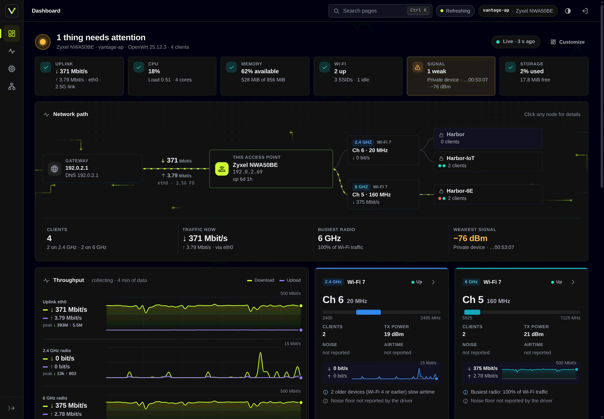
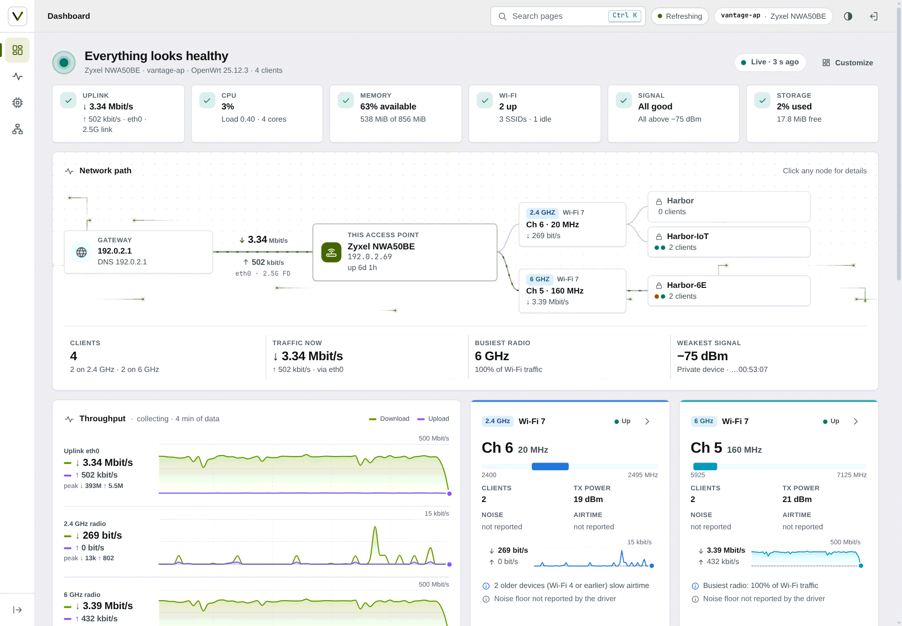
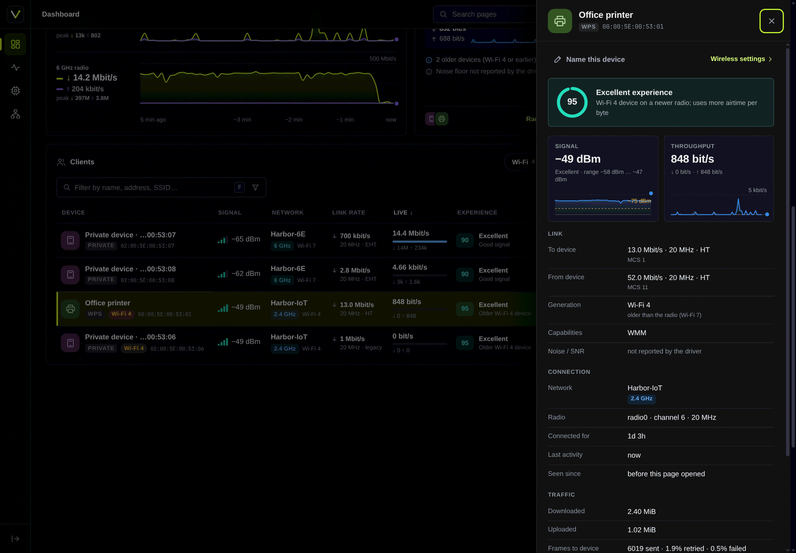
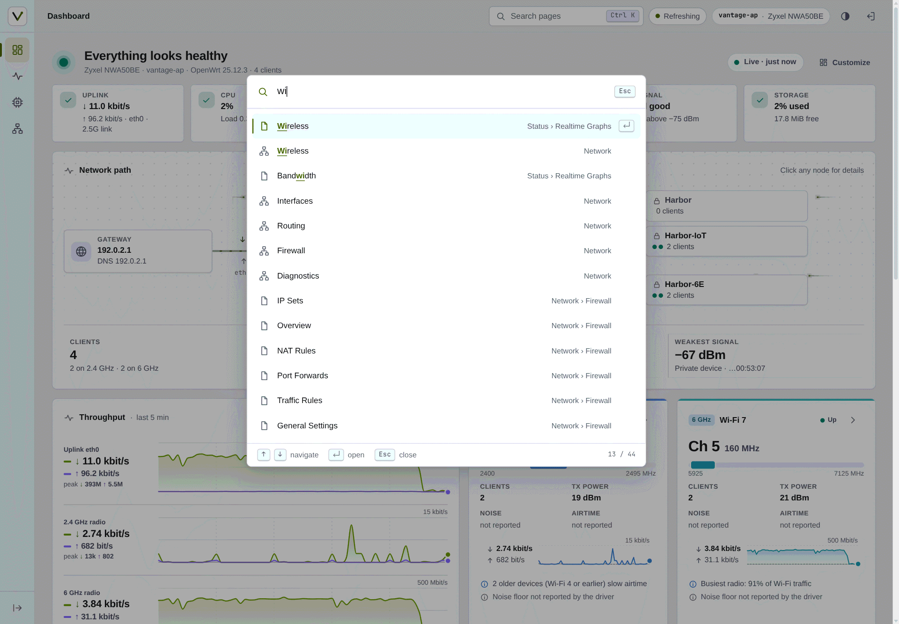
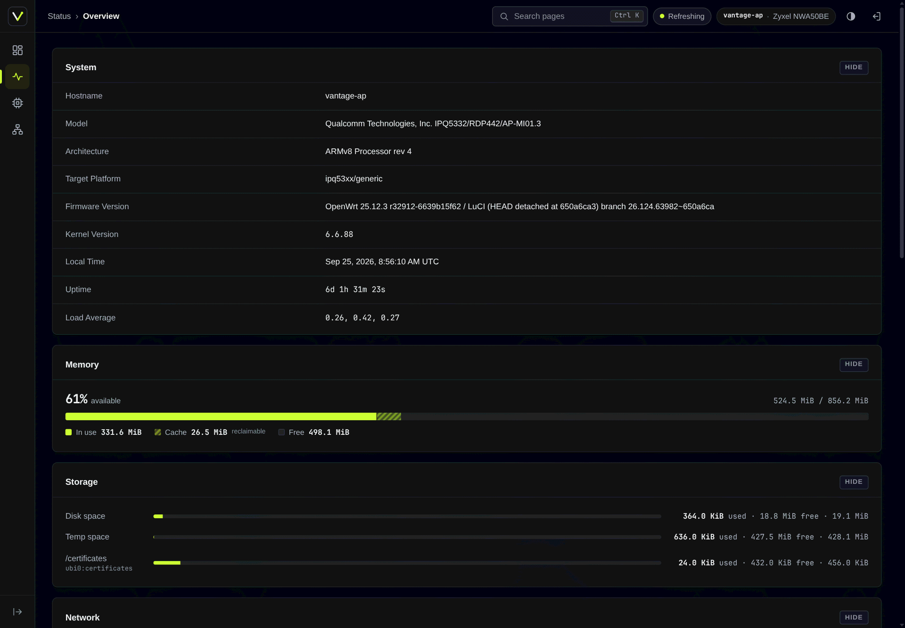
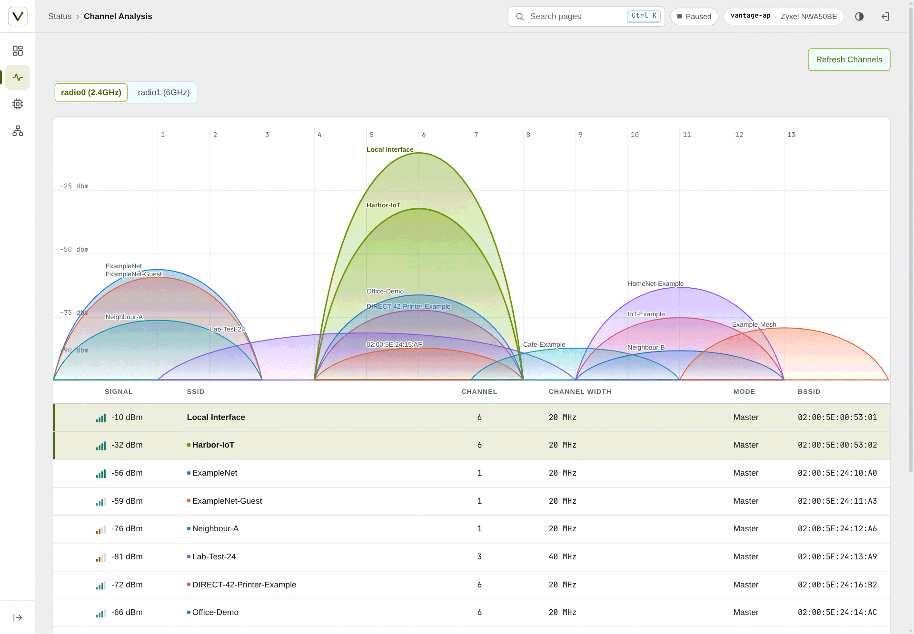
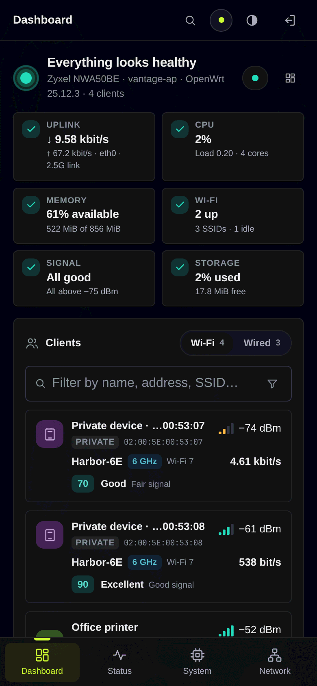

<div align="center">


# Vantage

**A LuCI theme and live network dashboard for OpenWrt 25.12 and 24.10, built from scratch.**

  

</div>

<br>

<p align="center">
  
</p>

<p align="center"><sub>Screenshots show recorded data from a real access point, pseudonymised
(documentation addresses and MACs, neutral names). See <a href="#develop">Develop</a>.</sub></p>

## What you get

Two packages. The app works under any LuCI theme; the theme is useful
without the app.

**`luci-theme-vantage`**, the shell:

- Icon rail with a flyout per category; a bottom bar and sheet on phones
- Breadcrumb, page tabs (the current crumb also switches between them),
  and a <kbd>Ctrl</kbd>+<kbd>K</kbd> / <kbd>/</kbd> command palette with
  fuzzy search over every page you can open
- Light, dark and auto modes, applied before first paint (no flash)
- Host chip (hostname and model), LuCI's indicators (including the unsaved
  changes count) as keyboard-accessible pills
- Its own login page, and restyled stock pages, forms, tables, charts and
  status icons; tables become cards on small screens
- Tidier stock pages: a table row with a main action (Edit, else the
  highlighted one) and two or more others shows the main one and folds
  the others into a ⋯ menu; Add, highlighted and an app's own buttons
  stay visible, and rows of equal actions (Startup, Processes) stay as
  LuCI drew them; firewall verdicts are coloured badges, with a warning
  colour where the internet-facing zone lets traffic in; the nftables
  chains are cards, and tooltips are never cut off
- One control size (bigger on touch screens) for fields, buttons and
  every tab, one tab style at every level, and field help folded to its
  first line
- System fonts, self-drawn SVG icons, no CDNs or frameworks

**`luci-app-vantage`**, the dashboard at `admin/dashboard` (the landing page):

- Health verdict with checks for uplink, CPU, memory, Wi-Fi, client signal
  and storage, each with a one-line reason; a check opens what it is
  about (a weak client's details, or the list when several are weak)
- Network path from gateway to access point, radios and SSIDs, and a
  Wired branch for the Ethernet ports; click any node for details. Behind
  it the login page's packets or starfield move with the live uplink
  rate (or nothing, as picked under Appearance)
- Live throughput for the uplink and every radio (last 5 minutes), in the
  chart style you pick under Customize (overlaid, log scale, mirrored or
  separate lanes),
  radio cards with channel, width, TX power and noise
- Clients with human names (your alias, reverse DNS, mDNS, DHCP hints, WPS
  device name, vendor, or "Private device" for randomised MACs), signal,
  link rate, Wi-Fi generation, live traffic and an experience score with
  its reason; filters by band, activity, weak signal and new clients.
  Wired devices too, from the bridge's table: port, link speed, traffic
  when a device has its port to itself (else the port's total), the ports
  of a swconfig switch behind a VLAN port, and when each was last heard
- Client inspector: signal history, link rates, capabilities, traffic,
  retries; rename a device in place
- Top talkers, wireless networks, system tile (CPU per core, memory,
  storage, firmware)
- Firewall overview (Network → Firewall → Overview): what is open from the
  internet, which zone reaches which, what is switched off or ignored, and
  warnings for the risky cases, read the way firewall4 reads the config;
  every item links to the LuCI page that changes it
- Your own layout: drag tiles, change their width or hide them; saved in
  the browser for each screen size, with a reset to the default

## Screenshots

<table>
  <tr>
    <td width="50%"></td>
    <td width="50%"></td>
  </tr>
  <tr>
    <td align="center"><sub>Light mode: health checks, network path and live throughput</sub></td>
    <td align="center"><sub>Client inspector with experience score, signal and link details</sub></td>
  </tr>
  <tr>
    <td width="50%"></td>
    <td width="50%"></td>
  </tr>
  <tr>
    <td align="center"><sub><kbd>Ctrl</kbd>+<kbd>K</kbd> palette: every page, fuzzy matched</sub></td>
    <td align="center"><sub>Stock Status page under the theme, with a combined memory bar</sub></td>
  </tr>
  <tr>
    <td width="50%" valign="middle"></td>
    <td width="50%" align="center"></td>
  </tr>
  <tr>
    <td align="center"><sub>Stock Channel Analysis (neighbour networks are generated)</sub></td>
    <td align="center"><sub>Phone layout with the bottom bar and the Wi-Fi/Wired switch</sub></td>
  </tr>
</table>

## Install

For OpenWrt 25.12 (apk). Both packages are architecture-independent, so
the same files install on any target. For 24.10 (opkg, signed `.ipk`
repository), see [OpenWrt 24.10](docs/INSTALL.md#openwrt-2410).

From the signed repository, on the router (once; later versions come with
`apk upgrade`):

```sh
wget -O /etc/apk/keys/vantage-signing.pem https://anothadev.github.io/luci-theme-vantage/vantage-signing.pem
sha256sum /etc/apk/keys/vantage-signing.pem   # must be c8a6c83eeb49ca2407932fb5e95785776128cef87db75ebaea0fe4171eee2157
echo 'https://anothadev.github.io/luci-theme-vantage/25.12/packages.adb' >> /etc/apk/repositories.d/customfeeds.list
apk update && apk add luci-theme-vantage luci-app-vantage
```

Or from the files of a
[release](https://github.com/anothaDev/luci-theme-vantage/releases) (or
[your own build](#build)), with the files in the current directory
(`192.0.2.1` stands for your router's address):

```sh
sha256sum -c --ignore-missing SHA256SUMS
scp -O luci-theme-vantage-*.apk luci-app-vantage-*.apk root@192.0.2.1:/tmp/
ssh root@192.0.2.1 'apk add --no-network --allow-untrusted /tmp/luci-theme-vantage-*.apk /tmp/luci-app-vantage-*.apk'
```

Log out of LuCI and back in; the dashboard is now the landing page. On a
fresh install the theme selects itself; an upgrade never overrides the
theme you chose (System → System → Language and Style). Removing the theme
switches LuCI back to Bootstrap.

**[The install guide](docs/INSTALL.md)** covers requirements, verifying
the packages, installing only one of them, upgrades, uninstalling,
building Vantage into your own firmware, troubleshooting, and a
ready-made prompt for installing with a coding agent.

## Build

With podman and the official OpenWrt SDK image:

```sh
dev/build/sdk-build.sh 25.12.4          # builds HEAD into dist/25.12.4/
```

The script builds from a clean clone of the commit in an SDK image pinned
by digest, so the same commit, SDK release and image always produce
byte-identical packages. It checks every package against the commit's
source (`security-tests/verify_built_apk.js`) before writing it to
`dist/<release>/`, next to `SHA256SUMS` and a `BUILDINFO` with the build
inputs. Optional index signing and the details are in the
[install guide](docs/INSTALL.md#build-from-source).

## Develop

The UI is developed offline against recorded device data, never against a
live device:

1. **Replay** – `dev/replay/` serves the complete LuCI UI on `127.0.0.1`
   from a recording of a real LuCI session (ubus replies, HTTP responses
   and static files; the format is in the replay's README) or from
   hand-written fixtures, with the theme and app loaded from this tree;
   reload to see an edit. Save & Apply works against an in-memory overlay.
   Recordings stay outside the repository.
2. **Demo mode** – `--demo` pseudonymises the recording as it loads:
   documentation MACs and addresses (`00:00:5E:00:53:xx`, `192.0.2.0/24`,
   `2001:db8::/32`), neutral hostname, SSIDs and client names. The
   screenshots above were taken this way.

```sh
node dev/replay/server.js --mirror ../vantage-mirror --port 8106 --demo \
    --theme-dir luci-theme-vantage/htdocs/luci-static/vantage --theme vantage \
    --app-dir luci-app-vantage
```

See [`dev/replay/README.md`](dev/replay/README.md) for all options,
[`docs/SPEC.md`](docs/SPEC.md) for the product and
[`docs/luci-contract.md`](docs/luci-contract.md) for what LuCI expects from a
theme. `dev/icons/build.js` generates the status icon set; `prototypes/`
holds the design prototypes the packages were made from. Coding agents
working on the repository should read [`AGENTS.md`](AGENTS.md).

Checks:

```sh
node --test tests/
dev/i18n/update.sh --check
node security-tests/check_dom_sinks.js
node security-tests/check_private_addresses.js [--require-mirror --mirror ../vantage-mirror]
node security-tests/test_templates.js
node security-tests/test_acl_policy.js
```

## Security

- **Read-only dashboard.** The app's rpcd ACL grants read methods only
  (system, network, iwinfo, hostapd status, host hints, mDNS, `/proc/stat`,
  and LuCI's swconfig switch port state) and no `file.exec`. Wireless configuration comes from the app's own rpcd
  ucode plugin (`luci.vantage wireless`), which leaves out Wi-Fi keys,
  SAE passwords and RADIUS secrets. Reverse DNS (`network.rrdns lookup`,
  which lets its holder aim the device's DNS queries at any server) is a
  separate, optional group, `luci-app-vantage-rdns`. The one write, device
  names, goes through the plugin's `set_alias`, which validates the name
  and MAC on the device and writes only `/etc/config/vantage` (at most 512
  names); it is in its own group, `luci-app-vantage-names`. No group grants
  uci writes. The firewall overview reads the `firewall` config (and the
  interface status, to find the uplink) and is
  shown only to sessions that hold LuCI's own `luci-app-firewall` group,
  which already reads and changes that config; the app grants nothing for
  it.
- **No markup from data.** Every DOM node is built with `E()` and text
  nodes; `check_dom_sinks.js` rejects `innerHTML` and other HTML sinks.
- **Templates.** `test_templates.js` renders the theme's templates with
  hostile input and checks that markup stays stable, inline scripts carry
  no data, the login error is generic and the theme adds nothing about the
  device to logged-out pages. LuCI's core header still adds its `L.env`
  script to every page (on anonymous 404 pages including the menu tree);
  that is upstream behaviour, tracked as a known failure, see
  `docs/luci-contract.md` section 2.
- **ACL policy.** `test_acl_policy.js` checks that the ACL grants exactly
  the methods the app declares, and nothing more.
- **No private data in the tree.** `check_private_addresses.js` rejects
  private IPv4/IPv6 addresses, MACs outside the documentation ranges, and
  the hostnames and SSIDs recorded from the real device.

## Compatibility

| OpenWrt | Status |
|---|---|
| 25.12 | Built with the 25.12 SDK and tested |
| 24.10 | Signed `.ipk` packages since 1.0.8, built with the 24.10 SDK and tested on a 24.10.8 router without Wi-Fi ([install](docs/INSTALL.md#openwrt-2410)) |

## Languages

Available: English and Simplified Chinese (dashboard, thanks to
[@ntbowen](https://github.com/ntbowen)). Translations are very welcome.

To add a language: fork the repository, run
`dev/i18n/update.sh --add <lang>` (a LuCI language code such as `de` or
`zh_Hans`), translate the two new `.po` files and open a pull request
that touches only `po/` files. Preview your work in the replay with
`--lang <lang>`. The details are under
[Translations](CONTRIBUTING.md#translations).

Each translation installs as its own packages, e.g.
`apk add luci-i18n-vantage-de luci-i18n-vantage-theme-de`; see
[Languages](docs/INSTALL.md#languages) in the install guide.

## Contributing

Issues and pull requests are welcome; see
[`CONTRIBUTING.md`](CONTRIBUTING.md). A bug report should include your
OpenWrt version (`cat /etc/openwrt_release`), your browser, and
screenshots taken with the replay's `--demo` mode or with personal data
removed: no real IP addresses, MACs or SSIDs. Report security problems
privately as described in [`SECURITY.md`](SECURITY.md), not in a public
issue.

What changed in each release is in [`CHANGELOG.md`](CHANGELOG.md).
Planned work and ideas are in [`docs/ROADMAP.md`](docs/ROADMAP.md); next
up is searching clients, radios and networks with <kbd>Ctrl</kbd>+<kbd>K</kbd>.

## License

GNU General Public License v3.0 or later (GPL-3.0-or-later), see
[`LICENSE`](LICENSE) and
[`luci-theme-vantage/NOTICE`](luci-theme-vantage/NOTICE).
